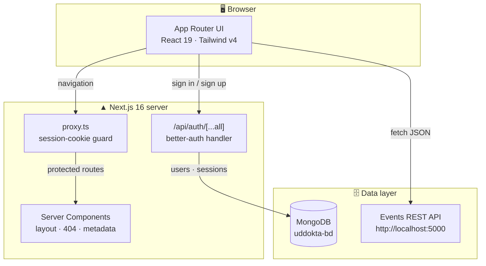

<p align="center">
  
</p>

<h1 align="center">Uddokta-BD</h1>

<p align="center">
  <strong>Small acts. Big changes.</strong><br/>
  A community events platform that connects people with meaningful social initiatives —
  from cleanups and tree plantations to education, healthcare and community development.
</p>

<p align="center">
  <a href="https://github.com/devwithefran99/uddokta-bd/stargazers">
    
  </a>
  <a href="https://github.com/devwithefran99/uddokta-bd/forks">
    
  </a>
  <a href="https://github.com/devwithefran99/uddokta-bd/issues">
    
  </a>
  
</p>

<p align="center">
  
  
  
  
  
  
</p>

---

## Table of Contents

- [Overview](#overview)
- [Features](#features)
- [Tech Stack](#tech-stack)
- [Architecture](#architecture)
- [Project Structure](#project-structure)
- [Getting Started](#getting-started)
  - [Prerequisites](#prerequisites)
  - [Installation](#installation)
  - [Environment Variables](#environment-variables)
  - [Run Locally](#run-locally)
  - [Production Build](#production-build)
- [Routes & Access](#routes--access)
- [Events API Contract](#events-api-contract)
- [Design System](#design-system)
- [Available Scripts](#available-scripts)
- [Quality Checks](#quality-checks)
- [Roadmap](#roadmap)
- [Contributing](#contributing)
- [License](#license)
- [Contact](#contact)

---

## Overview

**Uddokta-BD** is a full-stack community events platform for Bangladesh. Visitors can discover
upcoming social events, view event details and join with a single click. Signed-in members can
publish their own events, manage them from a personal dashboard, and keep track of everything
they have joined.

The frontend is a **Next.js 16 App Router** application styled with **Tailwind CSS v4** and
shadcn **base-nova** components, while authentication is handled end-to-end by **better-auth**
with a **MongoDB** adapter. Event data is served by a separate REST API running on
`http://localhost:5000`.

> **Design language** — deep emerald `#064E3B`, vivid brand green `#14A06F` and warm orange
> `#F0562F` on calm neutral surfaces. Belgrano typography, soft shadows, rounded cards and
> full dark-mode support throughout.

---

## Features

### 🎯 Discover & join
- **Auto-rotating hero carousel** with three editorial slides, manual navigation and progress indicators.
- **Live upcoming events** feed on the home page with category badges, dates, locations and hover motion.
- **Event discovery page** with a responsive card grid, loading state and a friendly empty state.
- **Event detail page** showing full description, date, time, location and the event identifier.
- **One-click join** — authenticated members can join an event; the action is persisted through the API.

### 🛠️ Create & manage
- **Create event form** with title, description, category selector, thumbnail URL, location and a
  future-only date picker.
- **Personal dashboard** with a total-events counter and dedicated cards for every event you own.
- **Inline edit dialog** for updating event details without leaving the dashboard.
- **Delete actions** with success feedback and automatic list refresh after every mutation.
- **Joined events library** that aggregates everything you have signed up for.

### 🔐 Accounts & security
- **Email + password** authentication with session-aware navigation.
- **Google OAuth** wired through the auth client and the sign-up flow.
- **Route protection** via Next.js 16's `proxy.ts` (the renamed middleware) with callback redirects.
- **Optimistic cookie guard** in front of `/events/*`, `/create-event`, `/manage-events` and `/joined-events`.

### ✨ Experience
- **Fully responsive** layouts from 320px phones to wide desktops.
- **Light / dark theme** with a persisted user preference and system default.
- **Custom 404 page** that keeps the navbar, footer and brand identity intact.
- **Accessible semantics** — labelled controls, `aria-*` attributes on icon-only buttons, and
  `noindex` handling baked into the framework's 404 response.

---

## Tech Stack

| Layer | Technology | Notes |
| --- | --- | --- |
| Framework | [Next.js 16.4](https://nextjs.org) | App Router, Turbopack, `cacheComponents`, partial prefetching |
| UI runtime | [React 19.3](https://react.dev) | Server Components by default, client islands where needed |
| Language | [TypeScript 5](https://www.typescriptlang.org) | Strict mode, `@/*` path alias to the repo root |
| Styling | [Tailwind CSS v4](https://tailwindcss.com) | Loaded through `@tailwindcss/turbopack` — no PostCSS config |
| Components | [shadcn](https://ui.shadcn.com) `base-nova` | Built on [Base UI](https://base-ui.com), not Radix |
| Animation | [`tw-animate-css`](https://github.com/Wombosvideo/tw-animate-css) | Utility-first motion primitives |
| Icons | [`lucide-react`](https://lucide.dev) | Consistent 1.8px stroke iconography |
| Auth | [`better-auth` 1.7](https://better-auth.com) | Email/password + Google OAuth, MongoDB adapter |
| Database | [MongoDB 7](https://www.mongodb.com) | Database name: `uddokta-bd` |
| Theming | [`next-themes`](https://github.com/pacocoursey/next-themes) | Class-based dark mode, system default |
| Notifications | [`react-toastify`](https://fkhadra.github.io/react-toastify) | Feedback for auth and dashboard actions |

**Font:** [Belgrano](https://fonts.google.com/specimen/Belgrano) via `next/font/google`
(`--font-belgrano`), loaded once in `app/layout.tsx`.

---

## Architecture



### Request lifecycle

1. A navigation request hits **`proxy.ts`** first. It reads better-auth's session cookie.
2. Missing cookie on a protected route → redirect to `/signin?callbackUrl=<original-path>`.
3. Cookie present → the request continues into the App Router and renders the page.
4. Client pages call the **Events API** on port `5000` for all event data.
5. Auth requests are handled by `app/api/auth/[...all]/route.ts`, which delegates to the
   better-auth server instance in `lib/auth.ts`.

> [!IMPORTANT]
> The frontend and the Events API are **separate services**. There are no local event routes in
> `app/api`; the page components talk to `http://localhost:5000` directly.

---

## Project Structure

```text
uddokta-bd/
├─ app/
│  ├─ api/auth/[...all]/route.ts   # better-auth Next.js handler
│  ├─ about/page.tsx               # mission, vision & values
│  ├─ create-event/page.tsx        # publish a new event
│  ├─ events/[id]/page.tsx         # event details + join action
│  ├─ joined-events/page.tsx       # personal event library
│  ├─ manage-events/page.tsx       # dashboard: edit / delete
│  ├─ signin/page.tsx              # email + Google sign-in
│  ├─ signup/page.tsx              # account creation
│  ├─ upcoming-events/page.tsx     # event discovery grid
│  ├─ not-found.tsx                # branded 404 page
│  ├─ globals.css                  # Tailwind v4 entry + design tokens
│  ├─ layout.tsx                   # navbar, footer, theme, font
│  └─ page.tsx                     # landing page composition
├─ components/
│  ├─ home/                        # hero, stats, recent events, gallery
│  ├─ shared/                      # Navbar, Footer
│  ├─ ui/                          # shadcn base-nova primitives
│  └─ theme-provider.tsx           # next-themes wrapper
├─ lib/
│  ├─ auth.ts                      # better-auth server config
│  ├─ auth-client.ts               # browser auth client + hooks
│  └─ utils.ts                     # `cn` class-merge re-export
├─ public/Image/uddokta-logo.png   # brand asset (case-sensitive path)
├─ proxy.ts                        # route guard (Next 16 middleware)
├─ next.config.ts                  # images, Turbopack, caching flags
├─ components.json                 # shadcn configuration
└─ package.json
```

---

## Getting Started

### Prerequisites

| Requirement | Version |
| --- | --- |
| Node.js | `>= 20.9.0` (Next.js 16 minimum) |
| npm | `>= 10` recommended |
| MongoDB | A reachable connection string (local or Atlas) |
| Events API | Running at `http://localhost:5000` |

### Installation

```bash
# 1. Clone the repository
git clone https://github.com/devwithefran99/uddokta-bd.git
cd uddokta-bd

# 2. Install dependencies
npm install

# 3. Create a .env file in the repo root — see the table below

# 4. Start the development server
npm run dev
```

Open **[http://localhost:3000](http://localhost:3000)** — the app hot-reloads as you edit.

> [!NOTE]
> Only one `next dev` instance may run per project. Starting a second one exits and prints the
> PID of the existing process.

### Environment Variables

Create a `.env` file in the repository root (it is git-ignored):

```bash
# ── MongoDB ────────────────────────────────────────────────
MONGODB_URI="mongodb+srv://<user>:<password>@<cluster>/uddokta-bd"

# ── better-auth ────────────────────────────────────────────
BETTER_AUTH_SECRET="a-long-random-string-used-to-sign-sessions"
BETTER_AUTH_URL="http://localhost:3000"

# ── Google OAuth (optional, for social sign-in) ────────────
GOOGLE_CLIENT_ID="<google-oauth-client-id>"
GOOGLE_CLIENT_SECRET="<google-oauth-client-secret>"
```

| Variable | Required | Description |
| --- | :---: | --- |
| `MONGODB_URI` | ✅ | MongoDB connection string. `lib/auth.ts` creates the client and uses the `uddokta-bd` database. |
| `BETTER_AUTH_SECRET` | ✅ | Secret used to sign sessions and cookies. Use a long, random value in every environment. |
| `BETTER_AUTH_URL` | ⚠️ | Public base URL of the app. Recommended in every environment; the client falls back to `http://localhost:3000`. |
| `GOOGLE_CLIENT_ID` | ⚠️ | Required only for Google sign-in / sign-up. |
| `GOOGLE_CLIENT_SECRET` | ⚠️ | Required only for Google sign-in / sign-up. |

> [!WARNING]
> `lib/auth.ts` instantiates `MongoClient` at module load. A missing or malformed `MONGODB_URI`
> causes auth routes to fail immediately — start the app with a valid connection string.

### Run Locally

```bash
npm run dev
```

| Service | URL |
| --- | --- |
| Frontend | `http://localhost:3000` |
| Auth endpoints | `http://localhost:3000/api/auth/*` |
| Events API | `http://localhost:5000` |

### Production Build

```bash
npm run build
npm run start
```

Before shipping, point the event fetches at your deployed API and set
`BETTER_AUTH_URL` to the production origin. Also register the production callback URL in
the Google OAuth console.

---

## Routes & Access

| Route | Access | Description |
| --- | --- | --- |
| `/` | Public | Landing page: hero carousel, impact stats, recent events, gallery |
| `/about` | Public | Mission, vision and platform values |
| `/upcoming-events` | Public | Full event discovery grid |
| `/events/[id]` | 🔒 Protected | Event details and join action |
| `/create-event` | 🔒 Protected | Publish a new event |
| `/manage-events` | 🔒 Protected | Personal dashboard with edit and delete |
| `/joined-events` | 🔒 Protected | Events the signed-in user has joined |
| `/signin` | Public | Email + Google sign-in |
| `/signup` | Public | Account creation |
| anything else | Public | Branded `404 — Page Not Found` page |

Protected routes are matched in `proxy.ts`:

```ts
export const config = {
  matcher: ["/create-event", "/events/:path*", "/manage-events", "/joined-events"],
};
```

---

## Events API Contract

The UI expects a REST API at **`http://localhost:5000`** with the following endpoints:

| Method | Endpoint | Used by | Purpose |
| --- | --- | --- | --- |
| `GET` | `/upcoming-events` | Home, Upcoming Events | Public upcoming event feed |
| `GET` | `/events` | Manage Events | Fetch every event (used after mutations) |
| `GET` | `/events/:id` | Event Details | Single event record |
| `POST` | `/events` | Create Event | Create an event (`creatorEmail` included) |
| `PATCH` | `/events/:id` | Manage Events | Update event fields |
| `DELETE` | `/events/:id` | Manage Events | Remove an event |
| `POST` | `/join-event` | Event Details | Join an event for the signed-in user |
| `GET` | `/joined-events?email=` | Joined Events | Events joined by a user |
| `GET` | `/my-events?email=` | Manage Events | Events created by a user |

**Event shape**

```jsonc
{
  "_id": "66f1c2a9e4b0a1f2c3d4e5f6",
  "title": "Community Cleanup Drive",
  "description": "A morning dedicated to cleaning our neighbourhood.",
  "eventType": "cleanup",
  "thumbnail": "https://example.com/cover.jpg",
  "location": "Dhaka, Bangladesh",
  "eventDate": "2026-11-15",
  "creatorEmail": "organizer@example.com"
}
```

> [!TIP]
> The base URL is currently hardcoded in the page components. For deployment, extract it into a
> `NEXT_PUBLIC_EVENTS_API_URL` environment variable and replace the literals in one pass.

---

## Design System

The interface follows a single, deliberately small palette. Match neighbouring components
rather than inventing new colors.

| Token | Value | Usage |
| --- | --- | --- |
| Brand green | `#14A06F` | Primary buttons, links, badges, active states |
| Green hover | `#10875E` / `#10865D` | Hover states on primary actions |
| Warm orange | `#F0562F` | Accents, highlights, secondary icons |
| Deep emerald | `#064E3B` | Hero overlays and dark brand surfaces |
| Navbar green | `#14532D` | Navbar actions, avatar ring (hover `#166534`) |
| Hero tint | `#F0FAF6` | About hero and 404 card background |
| Neutrals | `gray-50` → `gray-950` | Page surfaces, borders, body copy |

**Conventions**

- Cards: `rounded-2xl border border-gray-100 dark:border-gray-800 bg-white dark:bg-gray-900 shadow-sm`.
- Buttons: `rounded-lg` for inline CTAs, `rounded-full` for navbar/pill actions.
- Typography: bold `text-3xl`–`text-5xl` headings with tinted accent spans.
- Dark mode: always paired with a `dark:` variant; never rely on the default shadcn tokens for brand color.
- Assets live in `public/Image/` (capital **I**) — paths are case-sensitive on Linux and Vercel.

---

## Available Scripts

| Command | Description |
| --- | --- |
| `npm run dev` | Start the Turbopack dev server on port 3000 |
| `npm run build` | Create an optimized production build (type-checks the app) |
| `npm run start` | Serve the production build |
| `npm run lint` | Run ESLint across the repository |
| `npx next typegen` | Regenerate typed route props (`PageProps`, `LayoutProps`) |
| `npx tsc --noEmit` | Type-check without emitting output |

> [!NOTE]
> `next build` type-checks but no longer runs ESLint. Run `npm run lint` separately in CI.
> After adding or moving a route, run `npx next typegen` before `tsc` — `PageProps` and
> `LayoutProps` are generated into `.next/types`.

---

## Quality Checks

```bash
npm run lint
npx next typegen && npx tsc --noEmit
npm run build
```

**Known baseline issues** (pre-existing in the current tree — verify against `main` before
chasing them):

- ESLint reports unescaped apostrophes in `app/joined-events` and `app/signin`.
- `tsc` reports a type mismatch on the `Select` `onValueChange` handler in `app/create-event`.
- `react-toastify` is called from the navbar and auth pages, but no `ToastContainer` is mounted
  in `app/layout.tsx`, so those toasts do not render yet. `sonner` is installed but unused.

---

## Roadmap

- [ ] Move the Events API base URL into an environment variable for deployment.
- [ ] Mount a single notification provider (`sonner` **or** `ToastContainer`) in the root layout.
- [ ] Fix the `Select` handler typing in the create-event form.
- [ ] Wire the Google button on the sign-in page (only the sign-up page triggers OAuth today).
- [ ] Point the sign-in/footer links at `/signup` (they still reference `/register` and `/login`).
- [ ] Add server-side pagination and search to the event discovery feed.
- [ ] Add image uploads instead of thumbnail URLs.
- [ ] Introduce Playwright smoke tests for auth and event CRUD.
- [ ] Add rate limiting and server-side validation on the Events API.

---

## Contributing

Contributions are welcome. Please keep changes focused and consistent with the existing
patterns.

```bash
# 1. Fork and clone
git clone https://github.com/<your-username>/uddokta-bd.git
cd uddokta-bd
npm install

# 2. Create a branch
git switch -c feat/event-search

# 3. Make your changes, then verify
npm run lint
npx next typegen && npx tsc --noEmit

# 4. Commit and open a pull request
git commit -m "feat: add search to event discovery"
git push origin feat/event-search
```

**Before opening a PR**

- [ ] The app runs locally with a valid `.env` and the Events API on port `5000`.
- [ ] New UI works on mobile (375px), tablet and desktop, in both themes.
- [ ] Brand colors and card/button conventions match neighbouring components.
- [ ] No new lint or type errors beyond the documented baseline.
- [ ] Screenshots or a short clip are attached for visual changes.

**Commit style:** `feat:`, `fix:`, `docs:`, `style:`, `refactor:`, `chore:`.

---

## License

This project is **private and proprietary**. No open-source license has been added yet.
All rights reserved by the maintainers. Please contact the team before reusing or
redistributing any part of the codebase.

---

## Contact

| Channel | Details |
| --- | --- |
| Repository | [github.com/devwithefran99/uddokta-bd](https://github.com/devwithefran99/uddokta-bd) |
| Email | [info@uddoktabd.com](mailto:info@uddoktabd.com) |
| Issues | [Open an issue](https://github.com/devwithefran99/uddokta-bd/issues) |
| Location | Bangladesh 🇧🇩 |

<p align="center">
  <sub>Built with care for communities that show up for each other.</sub><br/>
  <sub><strong>Uddokta-BD</strong> — small acts, big changes.</sub>
</p>
